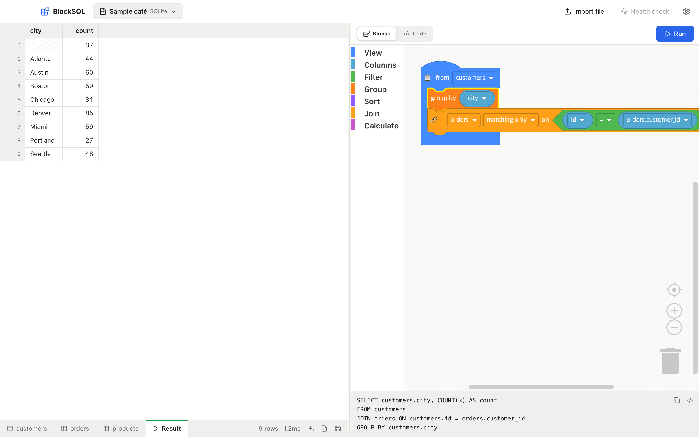
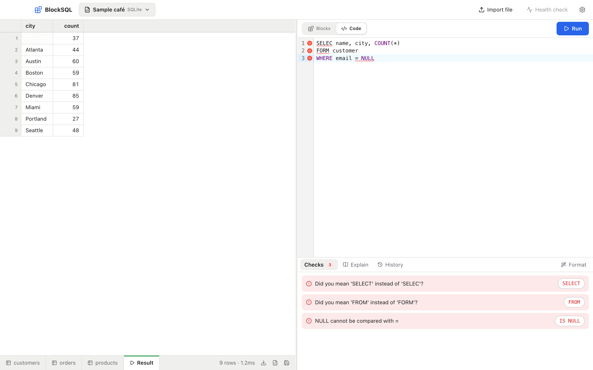
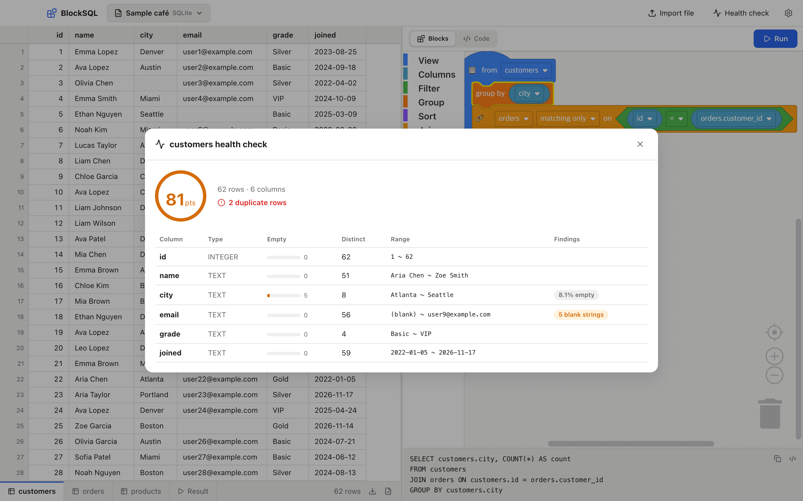
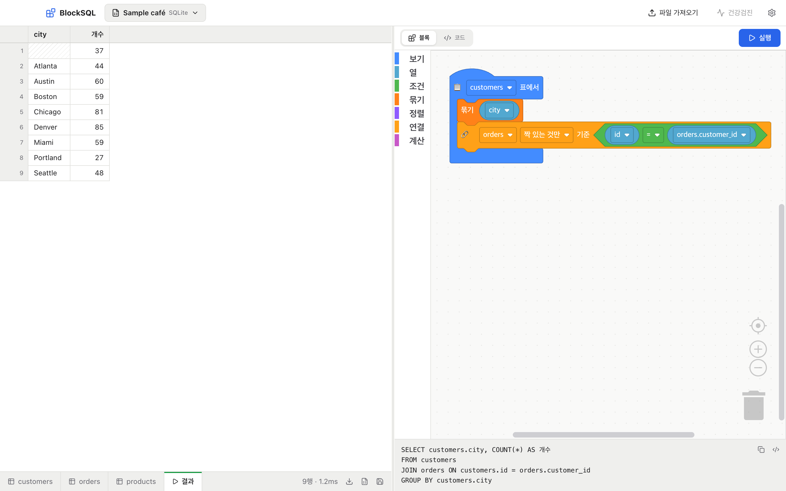
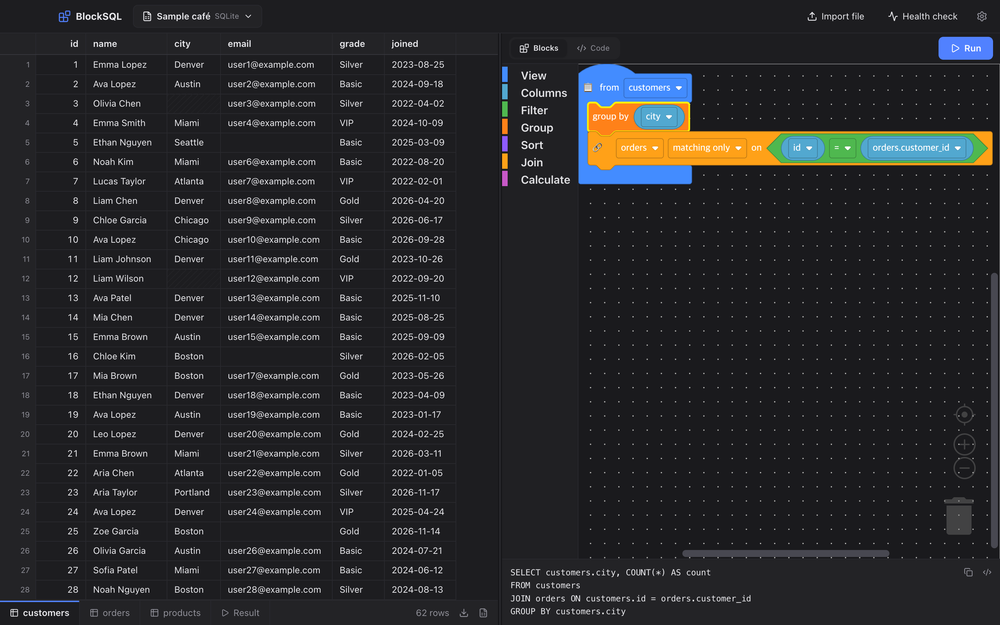

<p align="center">
  
</p>

<h1 align="center">BlockSQL</h1>

<p align="center">
  Drop in a spreadsheet, snap blocks together like Scratch, get SQL — with built-in query checks.<br/>
  <sub>엑셀 파일을 끌어다 놓고, 스크래치처럼 블록을 끼워서 SQL을 만드는 데스크탑 앱 · <a href="#한국어">한국어</a></sub>
</p>

<p align="center">
  <a href="https://github.com/Lvstw1205/blocksql/actions/workflows/ci.yml"></a>
  
  
  
</p>



## What it does

| | |
|---|---|
| **Spreadsheet on the left** | Drop CSV, Excel (.xlsx) or JSON files and they open as sheets. Multi-sheet workbooks become several tables. Korean CP949 CSVs and `"1,250,000"`-style numbers are read correctly. |
| **Blocks on the right** | Snap `filter`, `group`, `sort` and `join` blocks together; the SQL is generated and runs instantly. Block order doesn't matter. |
| **Sheet ↔ blocks** | Click a column header to spawn a show / filter / sort / group block for that column. |
| **Automatic joins** | Drop in a join block and the link (`orders.customer_id = customers.id`) is filled in from foreign keys or `<table>_id` naming. |
| **Code mode with checks** | Write SQL by hand and get inline diagnostics with **one-click fixes**: keyword typos (`FORM`), unknown tables/columns ("did you mean…"), `= NULL`, missing `GROUP BY`, trailing commas, AND/OR precedence. Plus a step-by-step explanation and database errors in plain language. |
| **Health check** | Scores any table: empty values, blank strings, duplicate rows, key candidates. |
| **Safe writes** | `UPDATE` / `DELETE` are dry-run first so you see how many rows will change. |
| **Export** | Save results as CSV or Excel, or as a new table. |
| **Databases** | SQLite files, PostgreSQL, MySQL. Passwords are encrypted with the OS keychain. |
| **Languages** | English by default, Korean in Settings. Switching relabels everything live, blocks included. |

<table>
  <tr>
    <td></td>
    <td></td>
  </tr>
  <tr>
    <td align="center"><sub>Code mode — find and fix mistakes</sub></td>
    <td align="center"><sub>Table health check</sub></td>
  </tr>
  <tr>
    <td></td>
    <td></td>
  </tr>
  <tr>
    <td align="center"><sub>Korean UI</sub></td>
    <td align="center"><sub>Dark mode</sub></td>
  </tr>
</table>

## Install

Download the installer for your OS from [Releases](https://github.com/Lvstw1205/blocksql/releases).

> macOS may warn about an unidentified developer: right-click the app → **Open**.

### Run from source

Requires Node.js 24+ (SQLite is built into Node, so there is nothing native to compile).

```bash
git clone https://github.com/Lvstw1205/blocksql.git
cd blocksql
npm install
npm run dev
```

| Command | |
|---|---|
| `npm run dev` | Development mode with hot reload |
| `npm test` | Tests |
| `npm run typecheck` | Type checking |
| `npm run package` | Installer for the current OS (in `release/`) |

To publish a release: `git tag v0.1.0 && git push --tags`. GitHub Actions builds macOS, Windows and Linux installers and attaches them to the release.

## How it is built

```
src/
  shared/              UI-independent core (unit tested)
    blockquery.ts      block tree → SQL for SQLite, PostgreSQL and MySQL
    doctor/            tokenizer, checks (lint), explanations, error translation
    health.ts          health-check queries and scoring
    i18n.ts            English / Korean messages
  main/                Electron main process
    db/                SQLite (node:sqlite), pg, mysql2 drivers
    importer.ts        CSV / Excel / JSON import with type inference and CP949 support
    ipc.ts             bridge to the renderer
  preload/             safe window.api bridge
  renderer/            React UI
    blocks/            Blockly block definitions, toolbox, blocks → query tree
    components/        sheet, block editor, code editor, dialogs
```

Blocks compile in two steps: **workspace → query tree (`BlockQuery`) → SQL**. The query tree knows nothing about Blockly, so it is tested on its own.

Built with Electron, React, Blockly and CodeMirror.

## 한국어

BlockSQL은 데이터는 있는데 SQL은 아직 모르는 사람을 위한 데스크탑 앱이에요. **설정 → 언어**에서 한국어로 바꿀 수 있어요.

- **왼쪽은 엑셀:** CSV·엑셀·JSON 파일을 끌어다 놓으면 시트로 열려요. 한글 CSV(CP949)도 그대로 읽어요.
- **오른쪽은 스크래치:** `조건`·`묶기`·`정렬`·`연결` 블록을 끼우면 SQL이 만들어지고 바로 실행돼요. 시트의 열 이름을 누르면 그 열로 블록이 생겨요.
- **코드 모드:** 직접 SQL을 쓰면 오타, 없는 열, `= NULL`, 빠진 `GROUP BY` 등을 찾아 버튼 한 번으로 고쳐요.
- **건강검진:** 빈 값, 중복 행 등을 검사해 점수를 매겨요.
- **안전 장치:** `UPDATE`/`DELETE`는 몇 행이 바뀌는지 먼저 보여줘요.

## License

[MIT](LICENSE)
